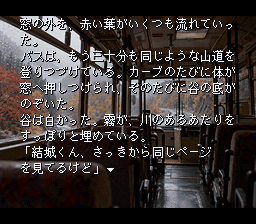

# Yonaki figure changes without a background blackout

The bundled ROM is the maintainer's validated `snes-roms` working-tree build
(base commit `6da6766`, including the reading dim from Issue #149).

`ApplySils` drains pending uploads before restoring/compositing the affected photo
columns in WRAM. VRAM continues to show the old composition during that work.
The new region is marked dirty after composition is complete and transferred in
V-blank slices. The figure-change-only full dim and its state were removed.
The reading dim stays at 2/31; scene transitions and scripted darkness still work.

The existing conservative old/new bounding-column transfer is retained. Figure
geometry can arrive over multiple frames; surrounding photo pixels stay stable.

## Before and after

Actual Snes9x output from the first bus-figure transition, captured frame by frame:

| Previous ROM | Updated ROM |
| --- | --- |
|  |  |

The photo probe above the figures and outside the text bitmap reached a mean RGB
value of 0 in the old recording. It stays at 157.9466 throughout the new recording.
The old dim level reached 31; the new recording stays at 2 throughout.

## Source validation

- `python3 -u -I tests/yonaki/run.py silhouette_updates`: the new regression failed
  on the previous engine with `silhouette update dimmed the photo` and passes on
  the updated engine.
- The regression observes four changes (1, 3, 2, then 0 visible figures) across
  139 busy frames. The unaffected background probe remains unchanged, each new
  composition reaches VRAM, and clearing all figures restores the original photo
  tile bytes exactly.
- `make yonaki-release`: all 12 Snes9x test groups passed, including all 20 real
  endings. All 21 bsnes fixture replays passed, including 12 intermediate/settled
  captures from the new figure-change test (maximum RGB difference 2).
- Figure regression: no V-blank overruns, no deferred DMA and no clipped text;
  maximum NMI end line 251 and DMA payload 3,072 bytes.

## Artifact

- `demos/yonaki.sfc`: 4,194,304 bytes, headerless LoROM, 8 KiB battery SRAM.
- SHA-256: `8f278e81ed3cec85a8d93aa834607572c754587f9bf1c2940baf46fe9b5080cb`.

Web build, browser CI and post-deployment evidence are recorded in the pull request
for Issue #152. Source-emulator checks do not claim that publication succeeded.
