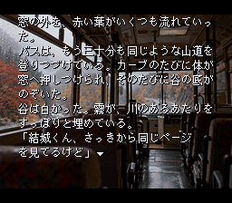

# Gradual Yonaki figure changes

The bundled ROM is the maintainer's validated `snes-roms` working-tree build,
based on `6da6766` with the reading dim and no-background-blackout fixes from
Issues #149 and #152, plus this transition change. It is not claimed to be a
separately published source commit.

Figures previously switched almost immediately after composition. The engine now
keeps a settled-photo copy in unused WRAM, compares the new composition against
it, and dissolves only changed pixels through eight fixed ordered-mask stages.
Each stage lasts at least four NMI frames, so the animation takes at least about
0.53 seconds. Preparation and larger multi-figure/solid-colour changes take longer;
the deliberately large mixed-colour fixture takes 216 animation frames.
Narration resumes after the transition settles.

All bitplanes of each pixel switch together. Unchanged tile pixels remain exact;
only changed tiles are submitted for DMA. Adjacent tiles share jobs within the
existing 3,072-byte V-blank budget. The settled copy equals the target after the
last stage. A shared tint-bank change also interpolates its colours, with special
handling for empty old/new scenes so white figures do not turn blue on departure.
The photo palette, text bitmap, reading dim (2/31) and SRAM format are preserved.

Public SFC *Kamaitachi no Yoru* footage was used to review translucent staging
and deliberate scene pacing: the [publisher-linked gameplay archive](https://www.spike-chunsoft.co.jp/pages/scps/archive02.html)
and an [unobstructed SFC English-patch recording](https://www.youtube.com/watch?v=i4wRqqGkR-4&t=360s).
This implementation uses an ordered-pixel dissolve. It does not claim the original
game's rendering algorithm or exact transition timing. No original game data or
artwork was imported.

## Before and after

Actual Snes9x output from the first bus-figure transition:

| Previous published ROM | Updated ROM |
| --- | --- |
|  |  |

The new recording contains 64 emulated frames, including a short lead-in and
post-transition hold. Its unaffected photo probe remains at mean RGB 157.9466,
and the reading dim remains 2 throughout. There is no full-background fade.

## Source and core validation

- `make yonaki-release`: all 12 Snes9x groups passed, including all 20 real endings,
  controls, fast-forward, names, effects and save/load.
- The figure regression observes addition, mixed-colour addition, removal with
  retained figures, then full clear (1, 3, 2, 0 figures). At every intermediate
  frame each photo pixel equals either its old or final value, transition progress
  never reverses, and at least seven intermediate levels are visible. Each settled
  VRAM picture equals PHOTO; full clear restores the original photo bytes exactly.
- All 21 pinned bsnes fixture traces passed with byte-equal battery images and
  maximum RGB difference 2. The figure trace includes 18 preparation, intermediate
  and settled captures. The initial larger CPU blend batch caused cross-core timing
  drift; reducing it to 48 plane pairs per batch fixed it before this final run.
- Figure regression: no V-blank overruns, deferred DMA or clipped text; maximum
  NMI end line 258 and DMA payload 3,072 bytes.
- The existing browser Wasm core was instantiated in Node and driven using only
  joypad input and read-only observations of the real updated ROM. The first figure
  update occupied 42 observed busy frames, exposed all eight phases, held the dim
  at 2, and kept the background probe at mean RGB 157.6654 throughout. No emulator
  production code was changed.

## Artifact and browser verification

- `demos/yonaki.sfc`: 4,194,304 bytes, headerless LoROM, 8 KiB battery SRAM.
- SHA-256: `89110030d3fd97c97c2917420fc74c8c43fde5e6c92a27815c872601bbd07580`.
- The bundled ROM is byte-identical to the source workspace's tested release ROM.
- Shionari is unchanged, including its existing SHA-256 pin.

The web artifact build passes. Focused browser, required CI, and merge-triggered
Pages/live verification results are recorded in the pull request for Issue #155.
Native source checks alone do not assert publication succeeded.
